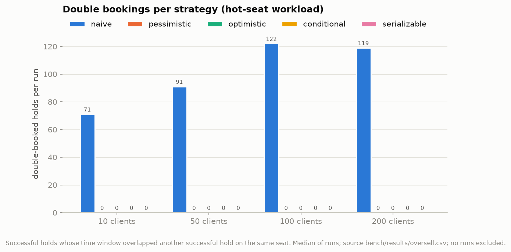
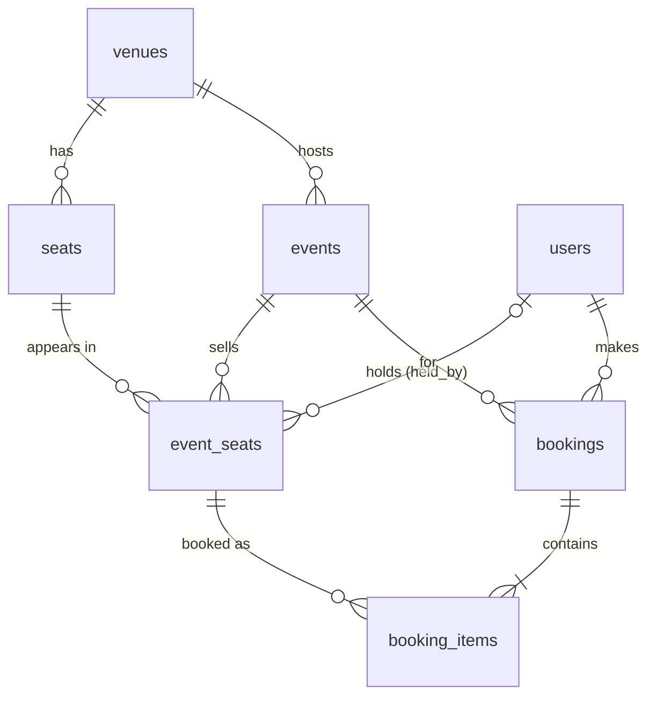
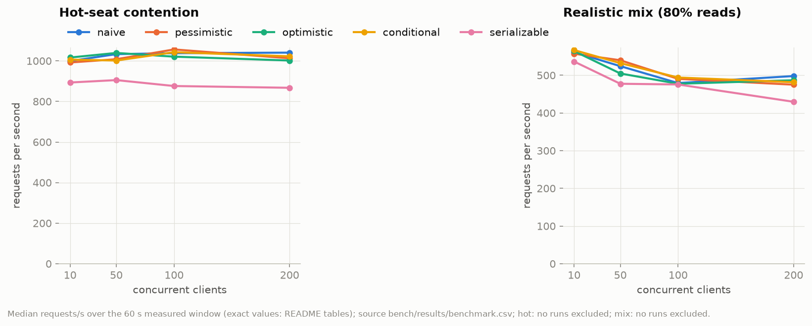
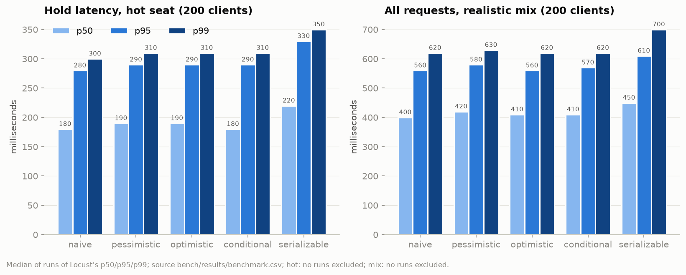
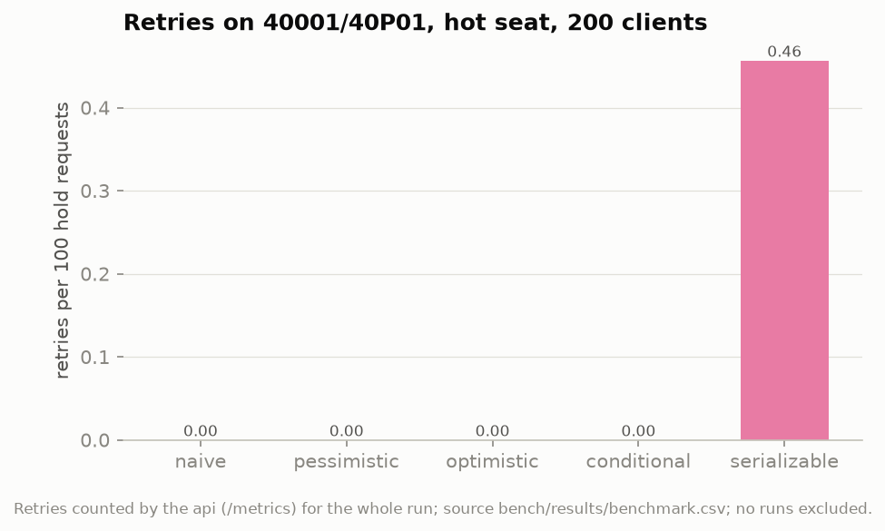
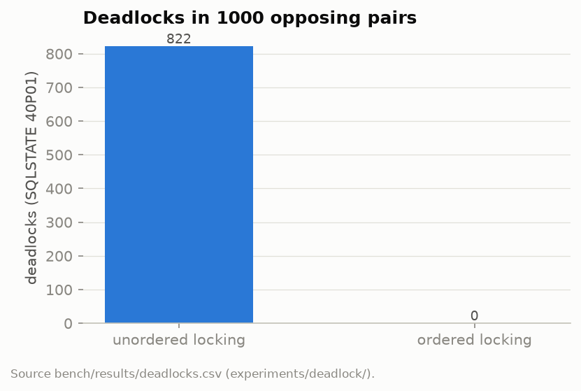

# SeatLock

When hundreds of people try to reserve the same seats at the same moment, a naive
read-then-write backend sells one seat to several people. SeatLock is a PostgreSQL
backend that shows, measures and prevents that, with five interchangeable locking strategies.



In the hot-seat benchmark (every client fights over the same 50 seats, 10 to 200 clients,
3 runs each) the naive strategy double-booked a median of 71 to 122 holds per 70-second run,
1,186 over its 12 runs, while the four correct strategies double-booked 0 in all 48 of theirs
([`bench/results/oversell.csv`](bench/results/oversell.csv)). A double booking here is two
successful holds on the same seat whose hold windows overlap ([`bench/verify_oversell.py`](bench/verify_oversell.py)).

## Quick start

```bash
make up        # PostgreSQL 18 and the API in Docker (copies .env.example to .env)
make migrate   # schema + indexes; safe to run twice
make test      # the test suite, against the real database
```

Then `make seed` loads small sample data, and the API answers on `localhost:$API_PORT`
(8000 by default, set in `.env`). Experiments: `make deadlock`, `make isolation`,
`make index-study`, `make bench`, `make pool-study`, `make plot`, `make summary`.

## Architecture

One FastAPI process with synchronous endpoints talks to PostgreSQL through a fixed-size
psycopg 3 connection pool; every HTTP request is one short transaction, and a seat hold
is a row state (`status`, `held_by`, `held_until`), never an open transaction. All SQL
is hand-written: the schema in [`db/migrations/`](db/migrations/), the queries as
parameterized strings next to the code that runs them. The contended table is
`event_seats`, one row per seat per event. A partial unique index on `booking_items`
(one active booking per seat) is the last line of defense if every other check fails.
Design choices and the alternatives rejected for each: [docs/design-decisions.md](docs/design-decisions.md).



Full diagram with columns: [docs/er-diagram.md](docs/er-diagram.md).

## The five strategies

Selected with `HOLD_STRATEGY`; all implement `hold(conn, event_id, seat_ids, user_id)` in
[`app/strategies/`](app/strategies/). Multi-seat holds always lock in ascending `seat_id`
and are all-or-nothing.

Hot-seat workload at 200 clients, median of 3 runs, from
[`bench/results/benchmark.csv`](bench/results/benchmark.csv) and
[`bench/results/oversell.csv`](bench/results/oversell.csv) (tables printed by `make summary`).

| Strategy | How it prevents the double booking | Double-booked holds per run | Hold req/s | Hold p99 ms | Retries per 100 holds | Realistic mix req/s |
| --- | --- | ---: | ---: | ---: | ---: | ---: |
| naive | It does not: reads the status, decides in Python, then writes without re-checking. Broken on purpose, the baseline. | 119 | 1,041 | 300 | 0.00 | 498 |
| pessimistic | `SELECT ... ORDER BY seat_id FOR UPDATE` locks the rows first; a second holder waits, then sees `HELD`. | 0 | 1,013 | 310 | 0.00 | 475 |
| optimistic | Reads `version` without locking, then `UPDATE ... WHERE version = <read>`; 0 rows updated means the race was lost. | 0 | 1,002 | 310 | 0.00 | 487 |
| conditional | One `UPDATE ... WHERE <seat is free> RETURNING`; the check runs under the row lock. Rows are locked in a CTE `ORDER BY seat_id`. | 0 | 1,023 | 310 | 0.00 | 482 |
| serializable | The naive code at `SERIALIZABLE`: Postgres aborts one of two conflicting transactions (40001) and the service retries. | 0 | 867 | 350 | 0.46 | TODO |

The serializable realistic-mix runs at 100 and 200 clients were measured after the laptop
lost AC power and are excluded; see [bench/results/INVALID_RUNS.md](bench/results/INVALID_RUNS.md).
Over every hot-seat run:

| Strategy | Runs | Runs with a double booking | Double-booked holds, total | Seat holds (api count), total | DB `version` sum equals api count |
| --- | ---: | ---: | ---: | ---: | --- |
| naive | 12 | 12 | 1,186 | 21,177 | all runs |
| pessimistic | 12 | 0 | 0 | 19,930 | all runs |
| optimistic | 12 | 0 | 0 | 19,952 | all runs |
| conditional | 12 | 0 | 0 | 19,990 | all runs |
| serializable | 12 | 0 | 0 | 19,733 | all runs |

<details><summary>Requests/s by client count (median of 3 runs)</summary>

Hot seat:

| Strategy | 10 clients | 50 clients | 100 clients | 200 clients |
| --- | ---: | ---: | ---: | ---: |
| naive | 999 | 1,033 | 1,038 | 1,041 |
| pessimistic | 992 | 1,008 | 1,056 | 1,013 |
| optimistic | 1,017 | 1,039 | 1,021 | 1,002 |
| conditional | 1,006 | 1,002 | 1,043 | 1,023 |
| serializable | 893 | 905 | 876 | 867 |

Realistic mix (serializable at 50 clients is one valid run; 100 and 200 are invalid):

| Strategy | 10 clients | 50 clients | 100 clients | 200 clients |
| --- | ---: | ---: | ---: | ---: |
| naive | 561 | 524 | 479 | 498 |
| pessimistic | 557 | 540 | 490 | 475 |
| optimistic | 564 | 505 | 477 | 487 |
| conditional | 567 | 532 | 494 | 482 |
| serializable | 536 | 504 | TODO | TODO |

</details>

What the numbers say:
- **Correctness was nearly free here.** Naive, pessimistic, optimistic and conditional all ran
  at 1,002 to 1,041 hold requests/s at 200 clients, and stayed flat from 10 to 200 clients.
  The api process, not the database, was the bottleneck: 40 s into each hot-seat run the api
  container used a median of 139% CPU against 36% for PostgreSQL and 35% for Locust
  (`docker stats`, files `bench/results/raw/*/*/*/docker_stats.csv`, median printed by
  `make summary`). Latency grows with clients because requests queue in the api.
- **Serializable is the one strategy with a visible cost:** 867 hold requests/s and a p99 of
  350 ms at 200 clients, against 1,002 to 1,041 and 300 to 310 ms for the others. It retried
  0.46 times per 100 holds on 40001, and a median of 1 request per run still failed after 3
  retries and got a 409. These numbers do not show which part of the cost comes from retries
  and which from the extra serializable bookkeeping.
- **A lost race is a 409, not a retry.** Optimistic shows 0 retries: a changed `version`
  means the seat is taken, so retrying could not succeed.





## Indexing study

The availability query (`AVAILABLE_SEATS_SQL` in [`app/services/events.py`](app/services/events.py))
measured with `EXPLAIN (ANALYZE, BUFFERS)` for 20 random events, first 3 discarded,
median of 17 ([`bench/index_study.py`](bench/index_study.py), results in
[`bench/results/index_study.csv`](bench/results/index_study.csv)). "Scan" is the plan
node that reads `event_seats`; "query" is the whole statement including the join to `seats`.

| Rows | Index configuration | event_seats scan node | Scan ms | Scan buffers | Query ms | Query buffers | Index size | Plan |
| --- | --- | --- | ---: | ---: | ---: | ---: | ---: | --- |
| 1M | none (primary key only) | Bitmap Heap Scan using event_seats_pkey | 0.787 | 119 | 17.282 | 1590 | 0 | [plan](docs/explain-plans/1M_none.txt) |
| 1M | plain `(event_id, status)` | Index Scan using idx_study_plain | 0.312 | 83 | 17.12 | 1554 | 7,176,192 B | [plan](docs/explain-plans/1M_plain.txt) |
| 1M | partial `(event_id) WHERE status = 'AVAILABLE'` | Index Scan using idx_study_partial | 0.3 | 83 | 17.102 | 1554 | 1,802,240 B | [plan](docs/explain-plans/1M_partial.txt) |
| 10M | none (primary key only) | Index Scan using event_seats_pkey | 1.458 | 120 | 18.306 | 1591 | 0 | [plan](docs/explain-plans/10M_none.txt) |
| 10M | plain `(event_id, status)` | Index Scan using idx_study_plain | 0.313 | 83 | 16.979 | 1554 | 71,622,656 B | [plan](docs/explain-plans/10M_plain.txt) |
| 10M | partial `(event_id) WHERE status = 'AVAILABLE'` | Index Scan using idx_study_partial | 0.31 | 83 | 16.944 | 1554 | 17,752,064 B | [plan](docs/explain-plans/10M_partial.txt) |

What the numbers say:
- "No index" is not a sequential scan: the composite primary key `(event_id, seat_id)` already
  starts with `event_id`. At 10M rows it reads all of the event's rows and filters
  (the plan shows `Rows Removed by Filter: 7564`).
- The partial index cuts the `event_seats` scan from 1.458 ms to 0.31 ms at 10M rows, at a
  quarter of the size of the plain index (17,752,064 vs 71,622,656 bytes) with the same speed.
  It became `idx_event_seats_available` in [`002_indexes.sql`](db/migrations/002_indexes.sql).
- The whole query barely moves (18.306 to 16.944 ms) because the join to `seats` dominates:
  the plans show a hash join over a sequential scan of all 200,000 `seats` rows (1,471 buffers).

## Deadlock and isolation experiments

**Deadlocks** ([`experiments/deadlock/`](experiments/deadlock/), [`bench/results/deadlocks.csv`](bench/results/deadlocks.csv)):
two transactions lock the same two seats in opposite orders, 1,000 random pairs each.

| Locking | Pairs | Deadlocks (40P01) |
| --- | ---: | ---: |
| unordered (A then B against B then A) | 1000 | 822 |
| ordered (seat ids sorted first) | 1000 | 0 |



The full PostgreSQL error and server log, read line by line: [docs/deadlock-error.md](docs/deadlock-error.md).

**Isolation levels** ([`experiments/isolation/`](experiments/isolation/), generated table in
[docs/isolation-results.md](docs/isolation-results.md) with every step each transaction saw):

| Scenario | READ COMMITTED | REPEATABLE READ | SERIALIZABLE |
| --- | --- | --- | --- |
| Lost update | anomaly occurred | transaction aborted (40001) | transaction aborted (40001) |
| Non-repeatable read | anomaly occurred | prevented | prevented |
| Write skew | anomaly occurred | anomaly occurred | transaction aborted (40001) |

Write skew at REPEATABLE READ is the interesting row: each transaction checks "at least one
VIP seat stays free", sees 2, and holds a *different* seat. No row is written twice, so
snapshot isolation sees no conflict, and the rule ends up broken. Only SERIALIZABLE notices
the read/write dependency cycle and aborts one transaction.

## Error handling

Mapped in [`app/main.py`](app/main.py); retries in `with_retries` ([`app/db.py`](app/db.py)).

| SQLSTATE | Meaning | Behavior |
| --- | --- | --- |
| 23505 | unique_violation | 409 |
| 23514 | check_violation | 400 |
| 23503 | foreign_key_violation (unknown user, event or seat) | 400 |
| 40001 | serialization_failure | retried up to 3 times with jittered backoff, then 409 |
| 40P01 | deadlock_detected | logged and retried up to 3 times, then 409 |
| 55P03 | lock_not_available (`lock_timeout`, 2 s) | 409 |
| none (PoolTimeout) | no pooled connection free within `DB_POOL_TIMEOUT_S` | 503 |
| anything else | | 500 |

Tests for each: [`tests/test_failures.py`](tests/test_failures.py), [`tests/test_api.py`](tests/test_api.py),
[`tests/test_constraints.py`](tests/test_constraints.py).

## Benchmark method and environment

- **Load:** Locust ([`bench/locustfile.py`](bench/locustfile.py)), closed loop (each simulated
  client sends its next request as soon as the last one returns), in a container on the same
  host and Docker network. Two workloads, run separately:
  hot seat (every client holds 1 to 3 random seats out of the same 50) and realistic mix
  (80% availability reads, 20% holds of 1 to 4 random seats over all 4 events).
- **Runs:** for each strategy, workload and client count (10, 50, 100, 200): reseed the
  small data set, recreate the api with that strategy, run 70 s and discard the first 10 s,
  3 repeats; medians reported ([`bench/run_all.sh`](bench/run_all.sh), 120 runs).
  Raw Locust CSVs, `/metrics` snapshots and CPU samples are in `bench/results/raw/`.
- **Holds last 2 s** during the benchmark, so seats keep freeing up and the contention lasts
  the whole run. Hot-seat runs turn the expiry sweeper off, so every write to a hot seat is a
  hold; the sum of the hot seats' `version` columns equals the api's own count of held seats
  in all 60 hot-seat runs.
- **Setup:** one uvicorn process, a pool of 10 connections, PostgreSQL 18.6 with default
  settings except `max_connections = 200`, all on one laptop (13th Gen Intel Core i7-13620H,
  16 logical CPUs, 15 GiB RAM). Full list: [bench/results/ENVIRONMENT.md](bench/results/ENVIRONMENT.md).
- **Power:** the laptop was unplugged near the end of the run. The 20 runs measured on
  battery are kept as evidence but excluded; [bench/results/INVALID_RUNS.md](bench/results/INVALID_RUNS.md)
  has the battery log and the throughput step that show it. The scripts now refuse to run on battery.

**Pool study** ([`bench/pool_study.sh`](bench/pool_study.sh): pessimistic, realistic mix,
200 clients, pool sizes 5, 20, 50 and 100): TODO. All 12 runs were measured on battery and are
invalid; they need to be re-run on AC power (commands in
[bench/results/INVALID_RUNS.md](bench/results/INVALID_RUNS.md)).

Machine, Docker limits, PostgreSQL settings and package versions, collected by a script:
[bench/results/ENVIRONMENT.md](bench/results/ENVIRONMENT.md).

## Limitations, and what I would change at 10x scale

- **The api is the bottleneck, not PostgreSQL** (139% against 36% CPU, above). The strategy
  comparison therefore shows what each strategy adds per request, not where each one stops
  scaling in the database. At 10x load I would run several api processes, so the database
  becomes the limit, and measure the strategies again; pessimistic locking should then start
  to cost more than conditional updates on hot seats, but this repo has not measured that.
- **One machine.** Locust, the api and PostgreSQL shared one laptop, so these are relative
  numbers, not a capacity claim.
- **The benchmark uses the small data set** (800 `event_seats` rows); the 1M and 10M tiers were
  used only for the index study.
- **At 10M rows the availability query is dominated by the join to `seats`** (a hash join over
  all 200,000 `seats` rows, 1,471 buffers, in every plan in `docs/explain-plans/`). That is the
  first thing I would work on at 10x data: the seat map of a venue rarely changes, so it could
  be read once and cached, or the join could be driven from the matching `event_seats` rows only.
- **At 100M rows** I would partition `event_seats` by event (for example by event date) so each
  event's rows and indexes stay small and finished events can be dropped as whole partitions.
  Contention would not change: it is per seat row, whatever the table size.
- **No authentication:** `user_id` comes from the request, anyone can cancel a booking by id,
  and idempotency keys are global rather than per user.
- **Expired holds reappear in listings only after the sweeper runs** (every 5 s), by design
  (see [docs/design-decisions.md](docs/design-decisions.md)); holds themselves never wait for it.

## What I learned

TODO: written by the author.
