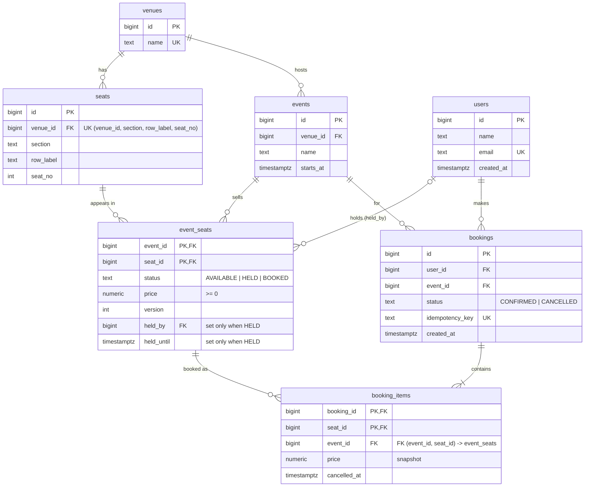

# ER diagram

Source of truth: [db/migrations/001_schema.sql](../db/migrations/001_schema.sql).

`booking_items` also has a partial unique index on `(event_id, seat_id) WHERE cancelled_at IS NULL`:
at most one active booking per seat per event.
